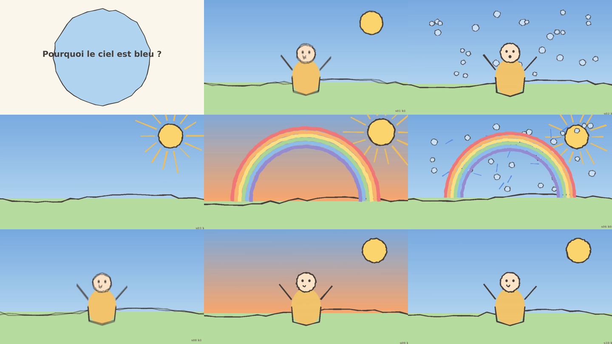

# cartoon-factory — dessins animés éducatifs 2D, 100 % en local

Pipeline qui transforme **une question** (« Pourquoi le ciel est bleu ? ») en
**un épisode de 30 s à 2 min** de dessin animé style crayon, avec voix off
française, sous-titres et export MP4 1080p (+ variante 9:16).

* **Cerveau** : Claude Code (abonnement, pas de clé API) écrit le script, pilote
  les étapes, regarde les images et relance les plans ratés (`/episode`).
* **Muscles** : ta machine — WSL2 Ubuntu, RTX 4060 Ti 16 Go. ComfyUI pour les
  dessins et l'animation, Kokoro/XTTS pour la voix, ffmpeg pour le montage.
* **Zéro API payante, zéro service externe.** Tout ce qui est décrit ici tourne
  hors ligne une fois les modèles téléchargés.

```
question ──► SCRIPT ──► PERSONNAGES ──► DESSINS CLÉS ──► VOIX ──► ANIMATION ──► MONTAGE
             Claude      fiches JSON     ComfyUI          Kokoro   ToonCrafter    ffmpeg
             episode.json (+LoRA opt.)   SDXL/Flux+LoRA   XTTS     Wan 2.2 I2V   1080p + 9:16
                                                                   Ken Burns      .srt
```

> La voix passe **avant** l'animation : la durée réelle de l'audio devient la
> durée du plan. C'est toujours la vidéo qui s'adapte à la voix.

## Aperçu (rendu placeholder, sans GPU)



`examples/ciel-bleu/preview/ciel-bleu_preview.mp4` : l'épisode test rendu en
mode `--backend placeholder --tts espeak` (croquis Pillow + voix synthétique
robotique). C'est exactement le même pipeline que le mode réel, seules les
briques « génération » sont remplacées : c'est ce qui permet de tester
l'orchestrateur, le cache, le montage et le skill sur une machine sans GPU.

---

## 1. Installation (WSL2 + RTX 4060 Ti 16 Go)

### 1.1 Prérequis Windows

1. **Driver NVIDIA** récent côté Windows (Game Ready ou Studio ≥ 535). Il
   inclut le support CUDA pour WSL — **ne pas** installer de driver dans Ubuntu.
2. WSL2 avec Ubuntu 22.04 ou 24.04 : `wsl --install -d Ubuntu-24.04`.
3. Dans `%UserProfile%\.wslconfig`, donner de la RAM à WSL (les modèles GGUF se
   chargent en RAM avant la VRAM) :
   ```ini
   [wsl2]
   memory=24GB
   swap=16GB
   ```
   puis `wsl --shutdown`.
4. Vérifier dans Ubuntu : `nvidia-smi` doit afficher la 4060 Ti et CUDA 12.x.

### 1.2 Installation automatique

```bash
git clone <ce dépôt> && cd taicorp-studio/cartoon-factory
COMFY_DIR=~/ComfyUI ./scripts/setup.sh        # ~10 min, idempotent
```

Le script installe : paquets système (ffmpeg, espeak-ng, aria2), ComfyUI dans
`~/ComfyUI` avec son venv PyTorch CUDA 12.4, les custom nodes
([ComfyUI-Manager], [ComfyUI-GGUF], [KJNodes], [VideoHelperSuite],
[ComfyUI-ToonCrafter]), un venv séparé `.venv/` pour l'orchestrateur, Kokoro
(`WITH_KOKORO=0` pour sauter), `comfy-mcp` (`WITH_MCP=0`) et, en option, XTTS
(`WITH_XTTS=1`). Il clone aussi les [workflows Wan 2.2 low-VRAM de Cordux] dans
`vendor/` comme référence.

[ComfyUI-Manager]: https://github.com/ltdrdata/ComfyUI-Manager
[ComfyUI-GGUF]: https://github.com/city96/ComfyUI-GGUF
[KJNodes]: https://github.com/kijai/ComfyUI-KJNodes
[VideoHelperSuite]: https://github.com/Kosinkadink/ComfyUI-VideoHelperSuite
[ComfyUI-ToonCrafter]: https://github.com/AIGODLIKE/ComfyUI-ToonCrafter
[workflows Wan 2.2 low-VRAM de Cordux]: https://github.com/Cordux/ComfyUI-Wan2.2-workflow

### 1.3 Modèles à télécharger

`scripts/download_models.sh [sdxl|flux|tooncrafter|wan|lora|all]` — toutes les
URLs sont des variables d'environnement à vérifier (`HF_TOKEN` pour les dépôts
sous licence comme Flux.1-dev). Les noms de fichiers doivent correspondre à
`config.yaml → comfy.models`.

| Rôle | Modèle | Taille | Dossier ComfyUI (`models/…`) |
|---|---|---|---|
| Dessins clés (défaut) | SDXL base 1.0 | 6,9 Go | `checkpoints/sd_xl_base_1.0.safetensors` |
| Dessins clés (option) | Flux.1-dev GGUF Q5_K_S | 8,3 Go | `unet/flux1-dev-Q5_K_S.gguf` |
| ↳ encodeurs Flux | clip_l + T5-XXL GGUF Q5_K_M + ae.safetensors | 0,25 + 3,4 + 0,33 Go | `clip/`, `clip/`, `vae/` |
| Style crayon | **LoRA à choisir** (Civitai / HF) | 50-400 Mo | `loras/<ton-fichier>.safetensors` |
| Interpolation | ToonCrafter 512 interp | 10 Go (fp16) | `checkpoints/tooncrafter/` |
| Image → vidéo | Wan 2.2 I2V A14B **high-noise** GGUF Q4_K_M | ~9 Go | `unet/` |
| Image → vidéo | Wan 2.2 I2V A14B **low-noise** GGUF Q4_K_M | ~9 Go | `unet/` |
| ↳ encodeurs Wan | umT5-XXL fp8, VAE Wan 2.1, CLIP Vision H | 6,7 + 0,25 + 1,3 Go | `clip/`, `vae/`, `clip_vision/` |

Compte **~55 Go** pour tout, ~20 Go pour un début confortable (SDXL + ToonCrafter
+ Ken Burns, sans Wan).

**LoRA de style** : cherche sur Civitai un LoRA SDXL « crayon », « children's
book illustration », « pencil sketch » ou « kids drawing ». Dépose-le dans
`models/loras/`, renseigne `style.lora.file` et, si l'auteur en indique un,
`style.lora.trigger` dans `config.yaml`. Rien n'est codé en dur : sans LoRA le
workflow fonctionne (le nœud est retiré automatiquement) mais le style sera
moins « dessin d'enfant ».

### 1.4 Flags VRAM recommandés

`scripts/run_comfy.sh` lance ComfyUI avec `--lowvram --disable-smart-memory
--preview-method auto` sur `127.0.0.1:8188` et
`PYTORCH_CUDA_ALLOC_CONF=expandable_segments:True`. Sur 16 Go :

| Étape | Réglage | VRAM observée |
|---|---|---|
| SDXL 1024×576, 28 pas | fp16, LoRA ×2 | ~7 Go |
| Flux GGUF Q5 + T5 Q5 | `--lowvram` indispensable | ~13 Go |
| ToonCrafter 512×320, 16 frames | `fp8_unet: true` dans le workflow | ~11 Go |
| Wan 2.2 I2V 480p, 49 frames, Q4 | experts chargés l'un après l'autre | ~14 Go |

L'orchestrateur appelle `POST /free` (déchargement complet) **entre chaque
étape** (`comfy.free_vram_between_stages: true`) : SDXL, ToonCrafter et Wan ne
sont jamais en mémoire en même temps. Si Wan déborde : `frames: 33`, `height:
416`, ou Q3_K_M.

### 1.5 Voix (TTS)

| Backend | Qualité | Coût | Installation |
|---|---|---|---|
| `kokoro` (défaut) | bonne, voix `ff_siwis` | CPU, ~1 s/phrase | `pip install kokoro soundfile "misaki[fr]"` + `espeak-ng` |
| `xtts` | très bonne, clonage de voix | GPU ~2 Go | `pip install TTS` ; `tts.xtts.speaker_wav` = 6-10 s de ta voix |
| `espeak` | robotique | instantané | `apt install espeak-ng` |
| `silence` | — | — | intégré (dry-run, tests) |

Changer de voix : `tts.backend` dans `config.yaml` ou `--tts xtts` en ligne de
commande. Le cache par plan est invalidé automatiquement si la voix change.

### 1.6 comfy-mcp dans Claude Code (optionnel)

Le serveur MCP officiel [comfy-mcp](https://github.com/Comfy-Org/comfy-mcp)
permet à Claude de lister les nœuds installés, de valider un workflow ou de
lancer un prompt directement. Dans `.claude/settings.json` (ou `.mcp.json` à la
racine du projet) :

```json
{
  "mcpServers": {
    "comfyui": {
      "command": "/chemin/vers/cartoon-factory/.venv/bin/comfy-mcp",
      "env": { "COMFYUI_URL": "http://127.0.0.1:8188" }
    }
  }
}
```

Le pipeline lui-même **n'en dépend pas** : `cartoon-factory` parle à ComfyUI en
HTTP direct. comfy-mcp sert surtout à déboguer un workflow (« quels nœuds
ToonCrafter existent ? », « pourquoi ce prompt échoue ? »).

---

## 2. Utilisation

### 2.1 Tout-en-un depuis Claude Code

```
/episode Pourquoi le ciel est bleu ?
```

Le skill (`.claude/skills/episode/SKILL.md`) : écrit le script, **demande ta
validation**, génère, vérifie chaque plan en regardant une image extraite,
relance ce qui est raté, et te rend le MP4.

### 2.2 En ligne de commande, étape par étape

```bash
source .venv/bin/activate            # ou préfixer par .venv/bin/
scripts/run_comfy.sh &               # ComfyUI en arrière-plan

cartoon-factory brief "Pourquoi le ciel est bleu ?"      # consignes pour écrire le script
cartoon-factory new   "Pourquoi le ciel est bleu ?"      # squelette output/<id>/episode.json
cartoon-factory validate  --episode output/ciel-bleu/episode.json
cartoon-factory characters --episode …                   # image de référence des persos
cartoon-factory keyframes --episode …                    # dessins clés (ComfyUI)
cartoon-factory voice     --episode …  [--tts xtts]      # wav par plan (durée réelle)
cartoon-factory animate   --episode …                    # clips par plan
cartoon-factory assemble  --episode …                    # MP4 1080p + 9:16 + .srt
cartoon-factory check     --episode …                    # 1 image/plan + rapport
cartoon-factory run       --episode …                    # tout ce qui précède
```

Options communes : `--shots s03,s07` (sous-ensemble), `--force` (ignorer le
cache), `--backend placeholder` (sans ComfyUI), `--out dossier`.

Reprendre un plan raté :

```bash
cartoon-factory reject s04 --episode … --reason "prisme illisible"   # invalide keyframes+animate
cartoon-factory keyframes --episode … --shots s04
cartoon-factory animate   --episode … --shots s04 && cartoon-factory assemble --episode …
```

### 2.3 Sans GPU (démo / CI)

```bash
cartoon-factory run --episode examples/ciel-bleu/episode.json --backend placeholder --tts espeak
```

Croquis Pillow façon crayon, fondu pour ToonCrafter, Ken Burns pour Wan, voix
espeak : ~90 s pour l'épisode complet, le rendu visible en tête de ce README.

### 2.4 Arborescence de sortie

```
output/ciel-bleu/
├── episode.json        # script figé pour ce rendu
├── cache.json          # empreintes par (étape, plan) — ne pas éditer
├── keyframes/ s01_k0.png s01_k1.png s02_k0.png …
├── voice/     s01.wav …            (mono 48 kHz, normalisé, + pause)
├── anims/     s01.mp4 …            (1080p, sans son, calé sur la voix)
├── final/
│   ├── shots/ s01.mp4 …  title.mp4 (vidéo + voix par plan)
│   ├── ciel-bleu_1080p.mp4         # master 16:9, piste sous-titres mov_text
│   ├── ciel-bleu_9x16.mp4          # recadrage vertical
│   └── ciel-bleu.srt
└── checks/    s01.png … report.md  # 1 image au milieu de chaque plan
```

---

## 3. Le script (`episode.json`)

Écrit par Claude d'après `cartoon-factory brief`. Par plan : `id`, `duration_s`
(3-5 s), `voice_text` (8-12 mots), `visual` (français, contenu seulement — le
style vient de la config), `characters`, `motion`, `method`, `camera`,
`keyframes[].prompt` (anglais, 2 prompts proches pour ToonCrafter).
`validate` refuse : durée hors 2-8 s, plus de 1,6× de texte que le plan ne
peut porter à 150 mots/min, méthode/caméra inconnue, personnage sans fiche,
total hors 20-150 s. Exemple complet : `examples/ciel-bleu/`.

Choix de méthode par plan (coût sur 4060 Ti) :

| `method` | Quand | Coût |
|---|---|---|
| `kenburns` | plan « illustration », narration | 1 image SDXL (~8 s) + ffmpeg |
| `tooncrafter` | geste / expression entre 2 dessins proches | 2 images + ~60 s |
| `wan_i2v` | mouvement libre (marche, chute, déploiement) | 1 image + 2-5 min |

## 4. Personnages cohérents

`characters/<id>.json` : description (FR), `prompt` (EN, réinjecté tel quel
dans chaque dessin), `negative_prompt`, `seed`, `palette`, `lora`. Le prompt
fixe + le LoRA style donnent déjà une bonne cohérence ; pour un perso
récurrent sur plusieurs épisodes, entraîne un LoRA :

```bash
cartoon-factory characters --episode … --dataset 24     # 24 dessins + captions
scripts/train_character_lora.sh pilou                   # kohya sd-scripts, ~30 min
# puis dans characters/pilou.json : "lora": {"file": "pilou.safetensors", "weight": 0.9, "trigger": "pilou_hedgehog"}
```

## 5. Configuration (`config.yaml`)

Sections : `project` (dossiers), `style` (préfixe de prompt, négatif, LoRA),
`video` (1920×1080, 24 fps, variante 9:16, crf), `keyframe` (résolution SDXL,
pas, cfg, seed de base), `comfy` (URL, timeouts, workflows, noms de modèles),
`animation` (réglages Ken Burns / ToonCrafter / Wan), `tts`, `subtitles`
(piste ou incrustés), `music` (fichier libre de droits, volume, fondus).
Tout changement pertinent entre dans l'empreinte de cache du plan concerné.

## 6. Développement

```bash
.venv/bin/ruff check src tests
.venv/bin/pytest -q                  # 13 tests, ~3 s, sans GPU ni réseau (ffmpeg requis pour l'e2e)
```

`src/cartoon_factory/` : `config` · `models` · `cache` · `context` · `comfy`
(client + placeholders) · `media` (ffmpeg) · `placeholder` (croquis) ·
`prompts` · `stage_script` · `stage_characters` · `stage_keyframes` ·
`stage_voice` · `stage_animate` · `stage_assemble` · `stage_check` · `tts/` · `cli`.

## 7. Limites connues / à faire

- Les graphes `tooncrafter.api.json` et `wan_i2v.api.json` ont été écrits sans
  pouvoir être exécutés ici : **vérifier les noms de nœuds** des custom nodes
  installés (procédure dans `workflows/README.md`) au premier lancement.
- Pas de LoRA de style livré (choix éditorial + licences) : emplacement prévu.
- La musique n'est mixée que si `music.file` pointe vers un fichier existant.
- Les sous-titres incrustés (`burn_in: true`) ré-encodent le master.
